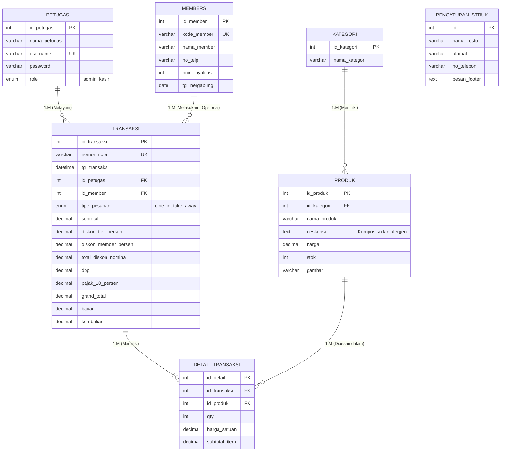

# Entity Relationship Diagram (ERD) - PoS Kasir MoonCafe
**Proyek:** Bootcamp UKK 2026 - Pemrogram Junior (Junior Coder)  
**Sekolah:** SMK Telkom Purwokerto  
**Standar Kompetensi:** BNSP `J.620100.004.02` (Menggunakan struktur data)

---

## 📊 Diagram Relasi Database

---

## 🔗 Detail Relasi & Kardinalitas

1. **`KATEGORI` → `PRODUK` (1 : M — One to Many)**
   - Setiap 1 kategori (misal: *Makanan*, *Minuman*, *Snack*) dapat memiliki banyak menu produk.
   - Setiap produk terikat pada tepat 1 kategori.

2. **`PETUGAS` → `TRANSAKSI` (1 : M — One to Many)**
   - Setiap 1 petugas kasir dapat melayani dan mencatat banyak transaksi penjualan.
   - Setiap struk transaksi mencatat ID kasir yang bertugas saat itu.

3. **`MEMBERS` → `TRANSAKSI` (1 : M — One to Many, Opsional)**
   - Pelanggan yang terdaftar sebagai Member dapat memiliki banyak riwayat transaksi.
   - Kolom `id_member` bersifat *nullable* (bernilai NULL jika pembeli adalah pelanggan umum).

4. **`TRANSAKSI` ↔ `PRODUK` (M : M — Many to Many melalui `DETAIL_TRANSAKSI`)**
   - Satu transaksi bisa membeli banyak menu makanan/minuman sekaligus.
   - Satu menu makanan/minuman bisa dipesan di banyak transaksi berbeda.
   - Tabel `DETAIL_TRANSAKSI` berfungsi sebagai *associative table* yang menyimpan `qty`, `harga_satuan`, dan `subtotal_item` secara permanen untuk integritas audit transaksi.

